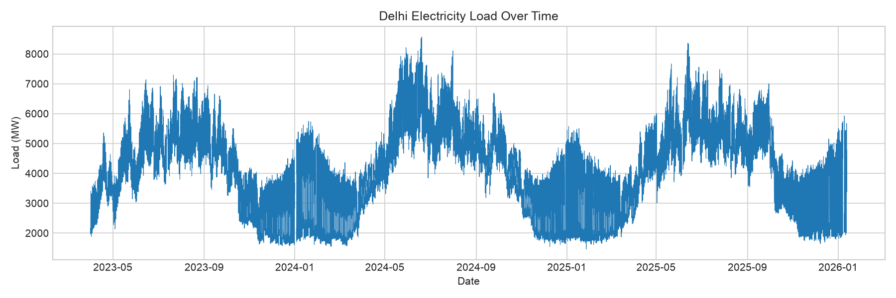
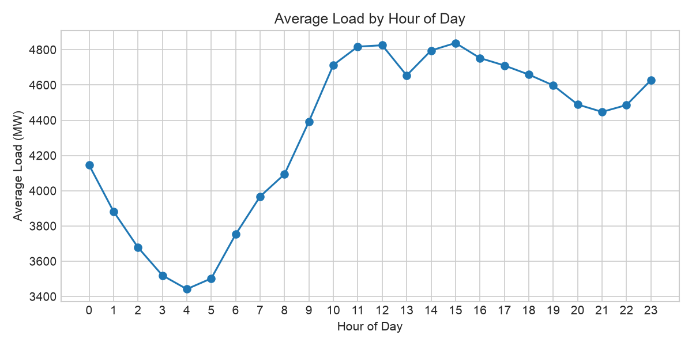
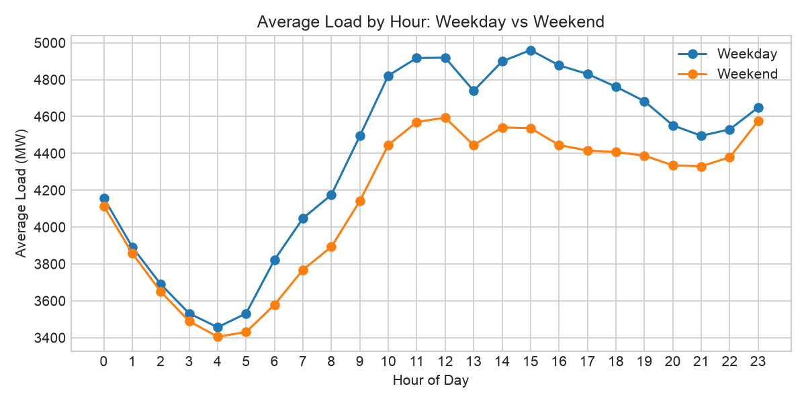
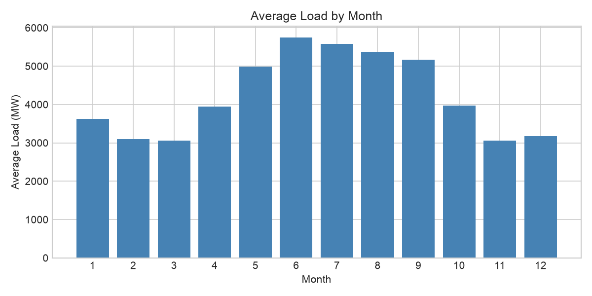
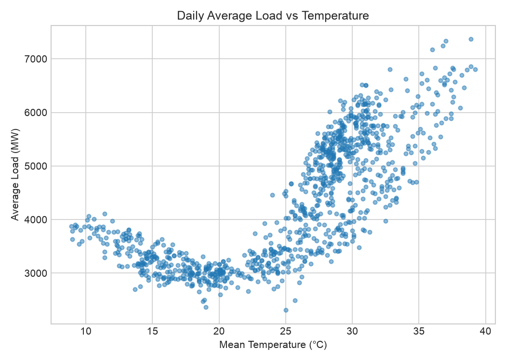
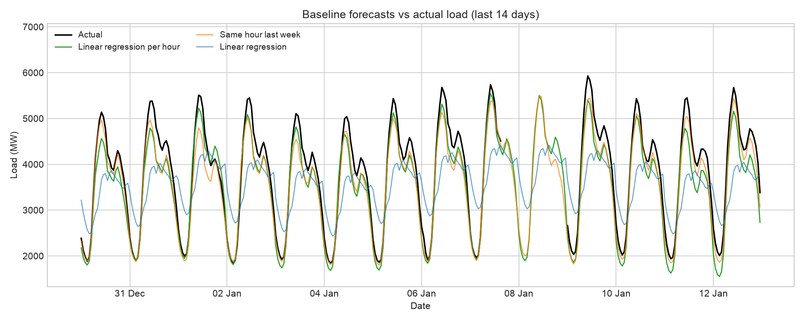
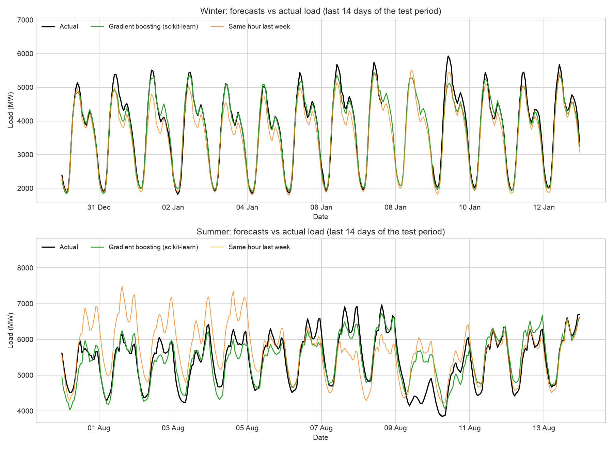
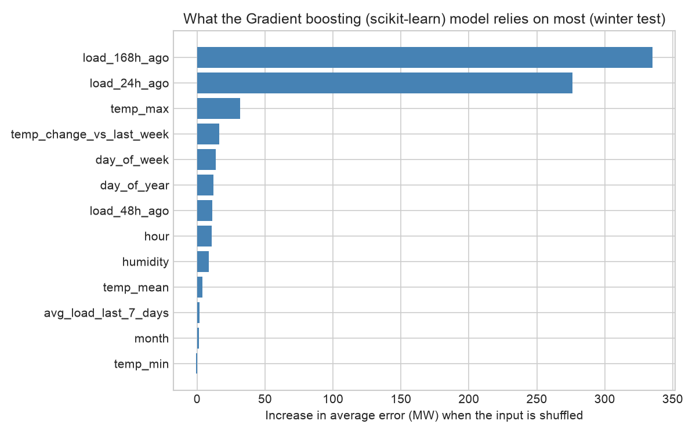
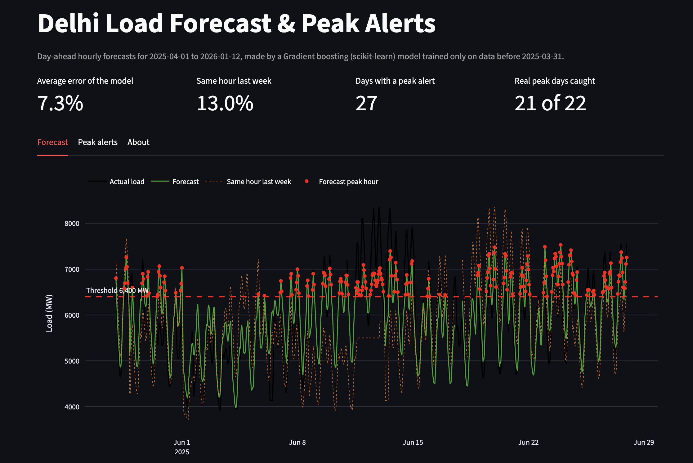

# Delhi Load Forecasting & Demand-Response Dashboard

## How this project started

I am an M.Tech student in Electrical Power Systems and Management at Jamia Millia Islamia, Delhi. Earlier, I completed an economic dispatch project using real grid data and transmission losses. That project worked out the cheapest way to supply a load, but it started with the load already known.

This raised a simple question for me: where does that load figure come from? In a real grid, operators do not know tomorrow's demand in advance. They have to forecast it. I decided to build my next project around this question, and I chose Delhi because I am doing my master's degree here, and its demand changes a lot between seasons.

The aim is to forecast Delhi's electricity demand from past load and weather data, and to show the result in a simple dashboard that marks expected peak hours.

## How I carried it out

### Step 1: Collecting the data

I used two sources:

- **Load data:** Delhi's electricity demand recorded every 5 minutes, starting from April 2023. I downloaded it from a Kaggle dataset of Delhi SLDC data. It has about 293,000 rows.
- **Weather data:** daily temperature and humidity for Delhi, taken from the Open-Meteo API with a small Python script.

I chose weather data because temperature is expected to affect demand strongly. People use more air conditioners in summer and heaters in winter.

### Step 2: Cleaning and merging

Data every 5 minutes is very detailed and noisy. I converted it to hourly averages, which gave about 24,400 rows. I then joined it with the weather data by date and added a few columns: hour of the day, day of the week, weekend or not, and month. A forecasting model needs these to learn daily and weekly patterns.

### Step 3: Looking at the data

Before building any model, I plotted the data to see what patterns exist. This is what I found.

**Load over the years**

The data covers about three years, from April 2023 to January 2026. The same shape repeats every year: load rises through spring, stays high in summer and drops in winter. Summer peaks were about 7,000 to 7,300 MW in 2023 and about 8,300 to 8,500 MW in 2024 and 2025. Winter lows are around 1,500 to 2,000 MW. The data has a few short gaps. The longest one I noticed is about a day and a half in early January 2026, and those hours are left out when scoring the models. Because the peaks grew between 2023 and 2024, I test the models on the most recent months.

**Daily pattern**

Load is lowest around 4 AM (about 3,450 MW on average). It rises quickly from 5 to 10 AM, stays high through the afternoon at about 4,700 to 4,850 MW, and peaks near 3 PM.

**Weekdays vs weekends**

Weekday load is higher than weekend load from about 6 AM to 11 PM, by up to about 425 MW (around 4,960 MW against 4,535 MW at 3 PM). Between midnight and 5 AM the two are almost the same. The morning rise also starts earlier on weekdays. Both curves show a small dip at 1 PM.

**Seasonal pattern**

Summer is the heaviest season. June has the highest average load (about 5,750 MW), and May to September all stay high. February, March and November are the lowest, at about 3,050 to 3,100 MW.

**Effect of temperature**

Load is lowest when the daily average temperature is between 17 and 23 degrees C (about 3,000 MW). Above 25 degrees it rises steeply, reaching about 7,000 to 7,400 MW at 37 to 39 degrees. It also rises a little below 12 degrees, probably because of heating.

The points are quite spread out. At the same temperature, daily load can differ by a few thousand MW. So temperature alone is not enough, and the model will also use humidity, hour, day of the week and month.

### Step 4: Baseline forecasts

Before building a proper model, I wanted a simple score to beat. I kept the last 90 days of data (15 October 2025 to 12 January 2026) aside and trained on everything before it. Then I tried three simple methods:

- **Same hour last week:** predict each hour with the load from the same hour one week earlier. No learning at all.
- **Linear regression:** one model using hour, weekday, month, temperature and humidity.
- **Linear regression per hour:** a separate regression for each hour of the day.

| Method | Average error (MAPE) | Typical error (RMSE) |
| --- | --- | --- |
| Same hour last week | 5.65% | 253 MW |
| Linear regression | 16.87% | 683 MW |
| Linear regression per hour | 10.54% | 417 MW |

I scored 2,118 hours. Hours with missing data were left out.

What I learned:

- The simple "same hour last week" method was the best of the three. I did not expect that.
- The single regression was the worst. It uses one daily shape for the whole year, but Delhi's winter days swing much more than summer days.
- Giving each hour its own regression cut the error from 16.9% to 10.5% and followed the daily shape much better. It still stayed a little below the real peaks. My guess is that it does not know that load has grown over the years, while "same hour last week" automatically follows the current level. I have not tested this yet.

Two limits to keep in mind. The test period is winter only, so these numbers say nothing about summer. And the regressions use the real temperature of each day, as if the weather forecast were perfect.

So the score to beat is about 5.65%. My next model will also use recent load values.

### Step 5: A stronger model

The baselines showed that last week's load is a strong starting point, but it gets worse when the weather changes. So for the next model I kept last week's load as the starting point and let the model learn how much to adjust it.

It is a gradient boosting model. Instead of predicting the load directly, it predicts the change from the same hour last week and adds that to last week's value. I used the scikit-learn version, because XGBoost did not load on my Mac. The inputs are the hour, day of week, month, temperature, humidity, the temperature change compared with last week, the load 24, 48 and 168 hours ago, and the average load of the last 7 days. Every load input is at least a day old, so this works as a day-ahead forecast.

I tested it on two periods, each time training only on data from before the test period.

**Winter test (14 October 2025 to 12 January 2026)**

| Method | Average error (MAPE) | Typical error (RMSE) | Average error in MW (MAE) |
| --- | --- | --- | --- |
| Same hour last week | 5.65% | 253 MW | 188 MW |
| Linear regression per hour | 10.63% | 420 MW | 354 MW |
| Gradient boosting | 3.87% | 185 MW | 128 MW |

**Summer test (15 May to 13 August 2025)**

| Method | Average error (MAPE) | Typical error (RMSE) | Average error in MW (MAE) |
| --- | --- | --- | --- |
| Same hour last week | 11.17% | 810 MW | 641 MW |
| Linear regression per hour | 6.52% | 473 MW | 376 MW |
| Gradient boosting | 5.65% | 422 MW | 319 MW |

What I found:

- Gradient boosting was the best method in both seasons. Compared with "same hour last week", its average error is about a third lower in winter and about half in summer.
- "Same hour last week" does badly in summer. In early August it overshoots the real load by more than 1,000 MW on some days. My guess is that summer weather changes a lot from week to week, so last week is a poor guide. I have not checked this.
- The per-hour regression was the second best in summer but the worst in winter.
- Even the best model is still off by about 4 to 6% on average, so it is useful but not perfect.

Limits to keep in mind:

- The models use the real temperature and humidity of each day, as if the weather forecast were perfect. With a real forecast the errors would be higher.
- I tested only two periods, and I did not model public holidays or festivals.
- I did not tune the model much. This is a first working version.

### Step 6: What the model relies on

To see which inputs the model uses most, I shuffled each input one at a time on the winter test data and measured how much the average error grew. A bigger increase means the model relies on that input more.

- The load from the same hour last week (about 335 MW increase) and from 24 hours earlier (about 276 MW) matter far more than anything else.
- Weather matters, but much less. The daily maximum temperature is the strongest weather input (about 32 MW), followed by the temperature change compared with last week (about 16 MW).
- Several inputs overlap, for example the three temperature columns and the lagged loads, so a single input can look less important than it really is. This chart is also from the winter test only.

### Step 7: Peak alerts and the dashboard

The last part turns the forecast into something a grid operator could look at. I built a Streamlit dashboard that replays the model's day-ahead forecasts for about nine months (1 April 2025 to 12 January 2026). The model was trained only on data before 1 April 2025, so it had not seen any of these hours.

Over the whole nine months the average error is 4.88% for the model and 9.76% for "same hour last week".

The dashboard has three tabs:

- **Forecast:** actual load, the forecast and "same hour last week" on one chart, with a threshold line and red dots on the hours forecast above it.
- **Peak alerts:** the days with forecast hours above the threshold. Each alert has a level (Low under 5% above the threshold, Medium 5% to 10%, High 10% or more) and a suggested action, for example asking large consumers to move load away from the peak hours. It also checks the alerts against what really happened: how many real peak days were caught, and how many were false alarms or missed.
- **About:** the data, the model and the limits.

The peak threshold and the date range can be changed in the sidebar. By default the threshold is 6,400 MW, which is the 95th percentile of the load in the training data.

Limits: the alert levels and actions are simple examples that I made up. I have not tested them on a real grid. The dashboard replays past data and is not a live feed.

To run it:

    python src/make_dashboard_data.py
    streamlit run app/dashboard.py

## What I plan to do next

1. Put the dashboard online so it can be opened from a link.
2. Try holidays and festivals as inputs, and test with a real weather forecast instead of the actual weather.

## Progress

- [x] Collected load and weather data
- [x] Cleaned and merged the data
- [x] Studied the patterns in the data
- [x] Baseline forecasting models
- [x] Stronger forecasting model
- [x] Peak-demand alerts
- [x] Dashboard
- [x] Write-up
- [ ] Put the dashboard online

## Project files

- `src/fetch_data.py` downloads the weather data and checks the load file
- `src/preprocess.py` cleans and merges the data
- `src/eda.py` creates the charts in `reports/figures/`
- `src/baseline_model.py` builds and scores the baseline forecasts
- `src/xgb_model.py` builds the stronger model and compares it with the baselines
- `src/make_dashboard_data.py` prepares the forecast data that the dashboard reads
- `app/dashboard.py` is the Streamlit dashboard and `app/demand_response.py` holds the peak alert rules
- `notebooks/` and `models/` are for the modelling work

## How to run it

The raw data files are not stored in this repository. Download the load CSV from Kaggle and save it as `data/raw/delhi_load_raw.csv`. Then run:

    pip install -r requirements.txt
    python src/fetch_data.py
    python src/preprocess.py
    python src/eda.py
    python src/baseline_model.py
    python src/xgb_model.py
    python src/make_dashboard_data.py
    streamlit run app/dashboard.py
