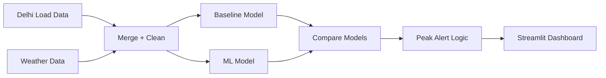

# Delhi Load Forecasting & Demand-Response Dashboard

**Dashboard preview:** _(screenshot will go here once Step 6 — the Streamlit app — is done)_

This project tries to predict how much electricity Delhi will need over the next few hours/days, using past load data and weather data. The idea is simple: electricity demand goes up when it's very hot or very cold (because of ACs and heaters), so if we can predict temperature-driven demand ahead of time, grid operators can plan better and avoid overloading the system during peak hours.

I built this as a follow-up to my earlier economic dispatch project. That project assumed the load was already known and optimized how to supply it. This one tries to answer a more basic question first — how much load are we even going to have?

## How it works



Raw load and weather data get merged and cleaned, then fed into two forecasting models so I can compare a simple baseline against a stronger ML model. Whichever forecast comes out gets checked against a peak threshold, and the result shows up on the dashboard.

## What's in this repo

- `data/` — the raw and cleaned data used for the project
- `notebooks/` — where I explored the data and built/tested the models
- `src/` — the actual scripts (data fetching, preprocessing, models, alert logic)
- `app/` — the Streamlit dashboard
- `models/` — saved trained models (not uploaded to GitHub, kept local)

## Data used

- **Load data**: Delhi's electricity demand, recorded every 5 minutes, from Delhi SLDC.
- **Weather data**: daily temperature and humidity for Delhi, pulled from the Open-Meteo API (free, no signup needed). Temperature is the main external factor driving demand, so it's a key input here, not just an extra column.

## Tools I'm using

Python, pandas, scikit-learn, XGBoost, Prophet/statsmodels for the forecasting, and Streamlit for the dashboard.

## Where I am with this project

- [x] Got the raw load and weather data collected and loading correctly
- [ ] Explore the data — look at daily/weekly/seasonal patterns and how load relates to temperature
- [ ] Build a simple baseline forecast (SARIMA or Prophet)
- [ ] Build a stronger model (XGBoost or LSTM) and compare it to the baseline
- [ ] Add logic that flags predicted peak-demand periods
- [ ] Build the dashboard
- [ ] Deploy it and write up the results

I'm updating this README as I go instead of writing it all at the end, so right now some sections are still empty on purpose.

## How to run this

```bash
git clone https://github.com/officialanas03/delhi-load-forecast-dashboard.git
cd delhi-load-forecast-dashboard
pip install -r requirements.txt
python src/fetch_data.py
streamlit run app/dashboard.py
```

## About me

I'm an M.Tech student in Electrical Power Systems and Management, based in Delhi. I'm building this as part of putting together a portfolio of real projects, not just coursework.
